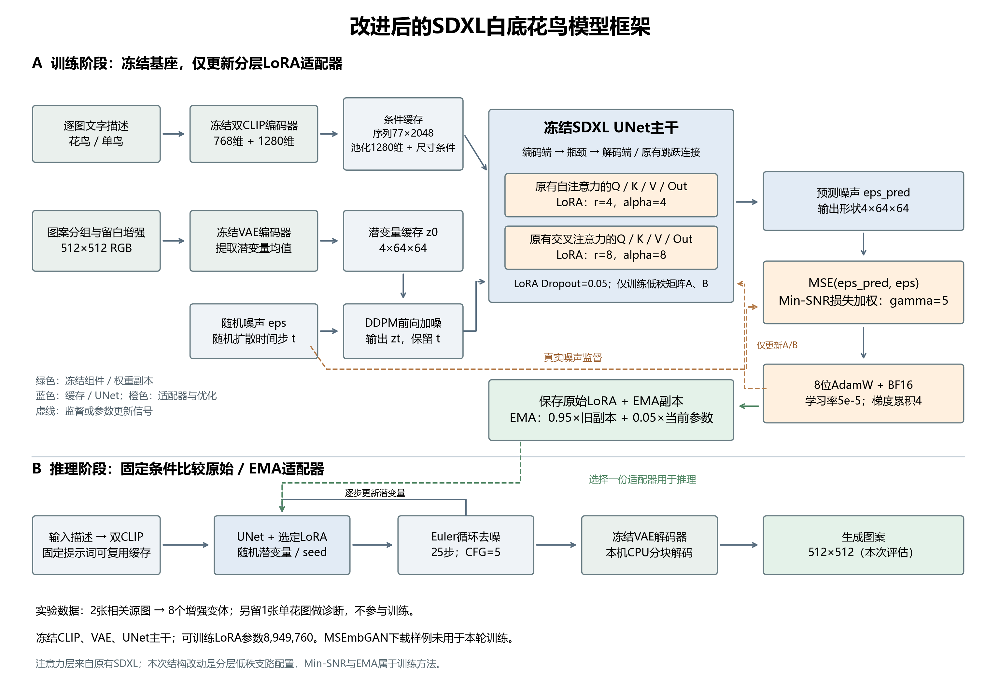
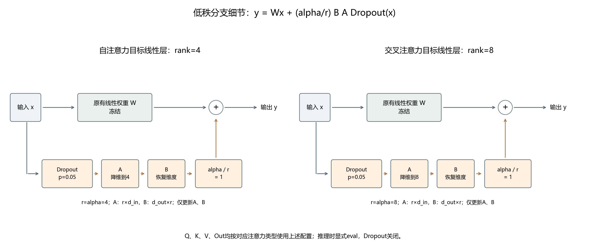

<!-- BASELINE_DATASET_FRAMEWORK_START -->
## 基准模型与对照版本

本实验的基准是 **Stable Diffusion XL Base 1.0（SDXL）**。它负责把文字条件映射为图像潜变量，再通过VAE解码；本轮没有训练直接输出落针坐标的模型，针迹规划仍属于后续独立处理。

| 项目 | 本次实际使用的信息 |
|---|---|
| 官方模型标识 | `stabilityai/stable-diffusion-xl-base-1.0` |
| 发布方 / 官方入口 | Stability AI；[官方模型页](https://huggingface.co/stabilityai/stable-diffusion-xl-base-1.0) |
| 固定版本 | `462165984030d82259a11f4367a4eed129e94a7b`，不是随时变化的`main` |
| 本地基础权重目录 | `E:/AMD_COMPETITION/Control/ml/models/sdxl-base-1.0` |
| 权重格式 | Diffusers组件式FP16 safetensors；20份权重、配置及分词文件，总计6,941,210,313字节，均已完成官方哈希核对 |
| 下载和来源核对 | 国内镜像用于传输加速；最终以官方固定版本的文件大小和哈希为准，VAE已按对应官方版本补齐 |
| 核心组件 | `UNet2DConditionModel`、`AutoencoderKL`、`CLIPTextModel`、`CLIPTextModelWithProjection` |
| 文字条件 | 两个编码器的隐藏维度分别为768、1280；拼接为77×2048序列，第二编码器另提供1280维池化向量 |
| 图像潜变量 | 本次512×512 RGB图经VAE空间降采样8倍，得到4×64×64潜变量；潜变量幅值缩放系数为0.13025，与空间降采样倍数是不同概念 |
| UNet主干 | 由实际参数计数扣除LoRA，基座UNet为2,567,463,684个参数；主干全冻结。通道配置320 / 640 / 1280，原有编码端、瓶颈、解码端和跳跃连接保留 |
| 调度器 | 训练前向加噪使用`DDPMScheduler`；生成评估使用基座配置中的`EulerDiscreteScheduler` |
| Refiner | 本次没有使用SDXL Refiner，不是Base＋Refiner双模型流程 |
| 使用说明 | 官方权重附带`LICENSE.md`；版本与文件校验依据保存在`ml/downloads/sdxl-official-inventory.json` |

1024×1024是该基座配置中常见的图像尺度；本实验为适配本机8GB显卡，训练和对照评估统一使用512×512。UNet分成10个文件仅是**无损重封装**，不是改变网络层数或减少参数量。

| 对照名称 | 定义 | 是否额外训练 |
|---|---|---|
| `base` | 固定官方SDXL基座，无任务LoRA | 否 |
| `pilot` / V1 | 上一版统一rank4 LoRA，使用花鸟、单鸟、单花三图，累计100步 | 已完成的上一轮试训练 |
| `raw` / V2原始 | 本轮自注意力rank4、交叉注意力rank8，使用逐图条件、Min-SNR及Dropout，100步 | 本轮训练 |
| `ema` / V2 EMA | 同一条V2训练轨迹的LoRA参数移动平均，decay=0.95 | 不是另一轮独立100步训练 |

本轮训练环境为Python 3.11.18、PyTorch 2.7.1+cu128、Diffusers 0.35.1、PEFT 0.17.1、Accelerate 1.10.1；硬件为NVIDIA GeForce RTX 5070 Laptop GPU，CUDA运行时12.8。完整版本见`environment.json`与`environment-freeze.txt`。

## 数据集来源与实际使用

### 实际参与V2实验的项目图案

实际数据来自项目已有的线稿资产目录`E:/AMD_COMPETITION/Control/AMD_fpga/src/assets`，不是把下载样例的1200个文件全部用于训练。

| 源文件 | 原始尺寸 / 像素 | 本轮用途 | 来源分组 |
|---|---|---|---|
| `bird-original.jpg` | 1257×1679 | 训练：4个增强变体 | 花鸟构图组 |
| `solo-bird.png` | 1536×1024 | 训练：4个增强变体 | 与花鸟整图同组 |
| `flower-original.png` | 518×453 | 诊断：1张，不训练 | 独立花图组 |

训练源文件共2张，但单鸟是花鸟图的局部，按同一来源组管理，只有**1个独立训练构图**。每张训练源图使用以下4种固定预处理，得到8个变体：

1. 保持比例，以白底留边到512×512。
2. 缩放到0.88倍后在白底居中，旋转−5°。
3. 缩放到0.88倍后在白底居中，旋转＋5°。
4. 缩放到0.94倍后在白底居中，水平翻转。

变体增加的是训练视图，不是新增独立作品；本轮没有把它们随机拆分后伪装为独立训练/验证集。单花图只有白底适配，不做训练增强，也不反向传播。
每张图的原始路径、SHA256、来源组、文字描述与预处理参数均记录于`dataset.json`。实际文字条件为：

- `bird-original.jpg`：`a small bird perched on a flowering branch with leaves, clean black line drawing on a white background, isolated embroidery motif`

- `solo-bird.png`：`one small bird in side view, clean black outline drawing, isolated on a white background`

- `flower-original.png`：`one five-petal flower with a round center, clean black outline drawing, isolated on a white background`

诊断使用单花图、固定时间步250/500/750及固定噪声种子`1234+timestep`，每次使用完全相同的潜变量、文字条件和噪声。这里的诊断loss用于监测一个未参与本轮训练的案例，不能等同于大样本验证精度。V1训练过这张花图，因此不能把它当作V1的未见测试集。

### 已下载、但本轮未用于训练的公开样例

| 项目 | 下载记录 |
|---|---|
| 名称 | MSEmbGAN作者公开的`MSEmb_DATASET_SAMPLE.zip` |
| 作者入口 | [MSEmbGAN项目页](https://csai.wtu.edu.cn/TVCG_01/index.html)；从该页的下载链接获取 |
| 范围 | **样例包**，不是完整数据集；也不是湘绣专用数据集 |
| 文件数量 | 1200个PNG文件；按文件SHA256没有完全重复，不能据此推断内容独立 |
| 原始压缩包大小 | 36,383,132字节，约36.38MB；ZIP CRC检查通过 |
| 压缩包SHA256 | `3cf091be3e92d8ca3cc4e07e64de77daefed0da5a8506b0d81cc2cc05d9a2456` |
| 本地目录 | `E:/AMD_COMPETITION/Control/ml/datasets/msembgan-sample` |
| 数据形式 | 包含aligned配对图、unaligned设计稿域`trainX_c`和刺绣效果域`trainX_e`；每类按本地目录计数100个文件，共12类目录 |
| 没有直接用于本轮的原因 | 初步抽查包含大量局部线条和色块，不能直接视为1200幅完整白底花鸟；缺少本轮需要的逐图语义描述与可靠独立来源划分 |
| 使用说明核对状态 | 样例包内未发现README/LICENSE，下载记录`licenseReviewed=false`；没有把“公开可下载”写成已核实开放许可 |

因此，本轮可以报告“已下载1200个公开样例文件”，但实际V2训练规模仍是上面明确列出的2张相关源图、8个变体和1张独立诊断图，不能把样例包数量当作本次训练数量。

## 改进后的模型框架

下图依据本次`train_v2.py`、`benchmark_one.py`和实际配置绘制，将训练与推理分开：实线表示数据流，橙色虚线表示监督或适配器参数更新；EMA只维护LoRA副本。

框架图下载：[SVG矢量版](figures/08_improved_model_framework.svg) · [PDF版](figures/08_improved_model_framework.pdf)。

低秩支路的具体插入方式如下；自注意力与交叉注意力本身属于原有SDXL，新增配置在它们的Q/K/V/Out线性变换上。W冻结，A和B训练；两类alpha/r都为1，推理时关闭Dropout。

支路图下载：[SVG矢量版](figures/09_lora_branch_detail.svg) · [PDF版](figures/09_lora_branch_detail.pdf)。
<!-- BASELINE_DATASET_FRAMEWORK_END -->
