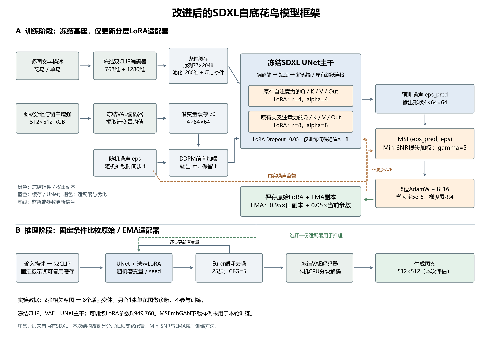
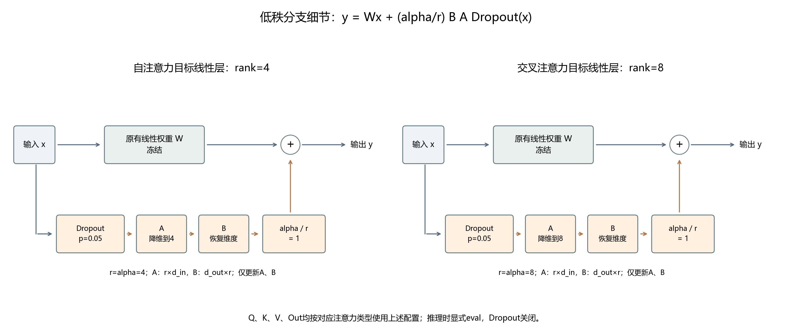

# SDXL白底花鸟：V2结构与训练实验

本次实际完成100次优化更新，训练及测量发生在本机RTX 5070 Laptop GPU，不是在FPGA上运行神经网络。
实验目录沿用2026-11-01创建的名称；本次结果整理日期为2026-11-02（北京时间）。
这是在极小数据上的改进实验，尚未证明可泛化到任意花鸟。请勿把参考截图中的loss、精度或“FPGA实时推理”结论复制到本项目。

<!-- BASELINE_DATASET_FRAMEWORK_START -->
## 基准模型与对照版本

本实验的基准是 **Stable Diffusion XL Base 1.0（SDXL）**。它负责把文字条件映射为图像潜变量，再通过VAE解码；本轮没有训练直接输出落针坐标的模型，针迹规划仍属于后续独立处理。

| 项目 | 本次实际使用的信息 |
|---|---|
| 官方模型标识 | `stabilityai/stable-diffusion-xl-base-1.0` |
| 发布方 / 官方入口 | Stability AI；[官方模型页](https://huggingface.co/stabilityai/stable-diffusion-xl-base-1.0) |
| 固定版本 | `462165984030d82259a11f4367a4eed129e94a7b`，不是随时变化的`main` |
| 本地基础权重目录 | `E:/AMD_COMPETITION/Control/ml/models/sdxl-base-1.0` |
| 权重格式 | Diffusers组件式FP16 safetensors；20份权重、配置及分词文件，总计6,941,210,313字节，均已完成官方哈希核对 |
| 下载和来源核对 | 国内镜像用于传输加速；最终以官方固定版本的文件大小和哈希为准，VAE已按对应官方版本补齐 |
| 核心组件 | `UNet2DConditionModel`、`AutoencoderKL`、`CLIPTextModel`、`CLIPTextModelWithProjection` |
| 文字条件 | 两个编码器的隐藏维度分别为768、1280；拼接为77×2048序列，第二编码器另提供1280维池化向量 |
| 图像潜变量 | 本次512×512 RGB图经VAE空间降采样8倍，得到4×64×64潜变量；潜变量幅值缩放系数为0.13025，与空间降采样倍数是不同概念 |
| UNet主干 | 由实际参数计数扣除LoRA，基座UNet为2,567,463,684个参数；主干全冻结。通道配置320 / 640 / 1280，原有编码端、瓶颈、解码端和跳跃连接保留 |
| 调度器 | 训练前向加噪使用`DDPMScheduler`；生成评估使用基座配置中的`EulerDiscreteScheduler` |
| Refiner | 本次没有使用SDXL Refiner，不是Base＋Refiner双模型流程 |
| 使用说明 | 官方权重附带`LICENSE.md`；版本与文件校验依据保存在`ml/downloads/sdxl-official-inventory.json` |

1024×1024是该基座配置中常见的图像尺度；本实验为适配本机8GB显卡，训练和对照评估统一使用512×512。UNet分成10个文件仅是**无损重封装**，不是改变网络层数或减少参数量。

| 对照名称 | 定义 | 是否额外训练 |
|---|---|---|
| `base` | 固定官方SDXL基座，无任务LoRA | 否 |
| `pilot` / V1 | 上一版统一rank4 LoRA，使用花鸟、单鸟、单花三图，累计100步 | 已完成的上一轮试训练 |
| `raw` / V2原始 | 本轮自注意力rank4、交叉注意力rank8，使用逐图条件、Min-SNR及Dropout，100步 | 本轮训练 |
| `ema` / V2 EMA | 同一条V2训练轨迹的LoRA参数移动平均，decay=0.95 | 不是另一轮独立100步训练 |

本轮训练环境为Python 3.11.18、PyTorch 2.7.1+cu128、Diffusers 0.35.1、PEFT 0.17.1、Accelerate 1.10.1；硬件为NVIDIA GeForce RTX 5070 Laptop GPU，CUDA运行时12.8。完整版本见`environment.json`与`environment-freeze.txt`。

## 数据集来源与实际使用

### 实际参与V2实验的项目图案

实际数据来自项目已有的线稿资产目录`E:/AMD_COMPETITION/Control/AMD_fpga/src/assets`，不是把下载样例的1200个文件全部用于训练。

| 源文件 | 原始尺寸 / 像素 | 本轮用途 | 来源分组 |
|---|---|---|---|
| `bird-original.jpg` | 1257×1679 | 训练：4个增强变体 | 花鸟构图组 |
| `solo-bird.png` | 1536×1024 | 训练：4个增强变体 | 与花鸟整图同组 |
| `flower-original.png` | 518×453 | 诊断：1张，不训练 | 独立花图组 |

训练源文件共2张，但单鸟是花鸟图的局部，按同一来源组管理，只有**1个独立训练构图**。每张训练源图使用以下4种固定预处理，得到8个变体：

1. 保持比例，以白底留边到512×512。
2. 缩放到0.88倍后在白底居中，旋转−5°。
3. 缩放到0.88倍后在白底居中，旋转＋5°。
4. 缩放到0.94倍后在白底居中，水平翻转。

变体增加的是训练视图，不是新增独立作品；本轮没有把它们随机拆分后伪装为独立训练/验证集。单花图只有白底适配，不做训练增强，也不反向传播。
每张图的原始路径、SHA256、来源组、文字描述与预处理参数均记录于`dataset.json`。实际文字条件为：

- `bird-original.jpg`：`a small bird perched on a flowering branch with leaves, clean black line drawing on a white background, isolated embroidery motif`

- `solo-bird.png`：`one small bird in side view, clean black outline drawing, isolated on a white background`

- `flower-original.png`：`one five-petal flower with a round center, clean black outline drawing, isolated on a white background`

诊断使用单花图、固定时间步250/500/750及固定噪声种子`1234+timestep`，每次使用完全相同的潜变量、文字条件和噪声。这里的诊断loss用于监测一个未参与本轮训练的案例，不能等同于大样本验证精度。V1训练过这张花图，因此不能把它当作V1的未见测试集。

### 已下载、但本轮未用于训练的公开样例

| 项目 | 下载记录 |
|---|---|
| 名称 | MSEmbGAN作者公开的`MSEmb_DATASET_SAMPLE.zip` |
| 作者入口 | [MSEmbGAN项目页](https://csai.wtu.edu.cn/TVCG_01/index.html)；从该页的下载链接获取 |
| 范围 | **样例包**，不是完整数据集；也不是湘绣专用数据集 |
| 文件数量 | 1200个PNG文件；按文件SHA256没有完全重复，不能据此推断内容独立 |
| 原始压缩包大小 | 36,383,132字节，约36.38MB；ZIP CRC检查通过 |
| 压缩包SHA256 | `3cf091be3e92d8ca3cc4e07e64de77daefed0da5a8506b0d81cc2cc05d9a2456` |
| 本地目录 | `E:/AMD_COMPETITION/Control/ml/datasets/msembgan-sample` |
| 数据形式 | 包含aligned配对图、unaligned设计稿域`trainX_c`和刺绣效果域`trainX_e`；每类按本地目录计数100个文件，共12类目录 |
| 没有直接用于本轮的原因 | 初步抽查包含大量局部线条和色块，不能直接视为1200幅完整白底花鸟；缺少本轮需要的逐图语义描述与可靠独立来源划分 |
| 使用说明核对状态 | 样例包内未发现README/LICENSE，下载记录`licenseReviewed=false`；没有把“公开可下载”写成已核实开放许可 |

因此，本轮可以报告“已下载1200个公开样例文件”，但实际V2训练规模仍是上面明确列出的2张相关源图、8个变体和1张独立诊断图，不能把样例包数量当作本次训练数量。

## 改进后的模型框架

下图依据本次`train_v2.py`、`benchmark_one.py`和实际配置绘制，将训练与推理分开：实线表示数据流，橙色虚线表示监督或适配器参数更新；EMA只维护LoRA副本。

框架图下载：[SVG矢量版](figures/08_improved_model_framework.svg) · [PDF版](figures/08_improved_model_framework.pdf)。

低秩支路的具体插入方式如下；自注意力与交叉注意力本身属于原有SDXL，新增配置在它们的Q/K/V/Out线性变换上。W冻结，A和B训练；两类alpha/r都为1，推理时关闭Dropout。

支路图下载：[SVG矢量版](figures/09_lora_branch_detail.svg) · [PDF版](figures/09_lora_branch_detail.pdf)。
<!-- BASELINE_DATASET_FRAMEWORK_END -->

## 添加或修改了什么

| 改动 | 实际实现与作用 | 证据 |
|---|---|---|
| 分层注意力LoRA配置 | 原有自注意力线性层增加rank4低秩支路，原有交叉注意力增加rank8支路；并未新造SDXL的注意力层 | config.json、权重元数据、图07 |
| 逐图文字与潜变量缓存 | 完整花鸟和单鸟分别配文字；冻结两套CLIP与VAE，提前编码后从训练GPU释放 | dataset.json、cached-tensors.pt |
| LoRA Dropout 0.05 | 仅训练态正则化；评估显式eval并检查所有Dropout关闭 | train_v2.py、benchmark_one.py |
| Min-SNR损失加权 | epsilon目标，gamma=5；同时保存未加权MSE，防止加权后的数值变小被误当精度提升 | metrics.csv、图01 |
| 适配器EMA副本 | decay=0.95，仅维护可训练参数的移动平均；原始权重另存，EMA不自动等于更优 | raw/、ema/、图02 |
| 低内存工程适配 | 原始FP16 UNet无损分为10片；训练BF16与梯度检查点；评估采用手动GPU UNet、CPU分块VAE | shard_unet.py、失败日志、benchmark日志 |

这些是在SDXL、LoRA、Min-SNR和EMA等已有方法上实现的组合实验，不是声称提出新算法。LoRA依据见[PEFT文档](https://huggingface.co/docs/peft/developer_guides/lora)，基础训练参考[Diffusers DreamBooth文档](https://huggingface.co/docs/diffusers/training/dreambooth)。
低秩更新为W'=W+(alpha/r)BA；自注意力使用r=alpha=4，交叉注意力使用r=alpha=8。Min-SNR epsilon目标权重为min(SNR,5)/SNR；EMA为0.95倍旧副本加0.05倍当前适配器参数。

## 数据与实验边界

V2训练使用项目的花鸟整图和其单鸟局部，二者作为同一来源组，构成1个独立训练构图；4种留白/微旋转/翻转配置生成8个变体，不能说成8个独立作品。
另一个单花图完全不用于训练，只用于固定噪声诊断。诊断仅1图、3个固定扩散时间步，不是足够规模的验证集。
V1曾使用全部3图，因此它和V2的数据划分、文字条件、学习率、损失目标都有差别；不把V1/V2的训练loss高低当作结构改动的因果证明。
本次没有用MSEmbGAN局部图块冒充完整白底花鸟，也没有生成不存在的准确率、FID或CLIP评分。

## 训练配置与结果

- 分辨率512×512，BF16，batch1，梯度累积4，8位AdamW，学习率5e-5，seed42，100步。
- V2可训练UNet适配器参数：8,949,760，其余UNet主干、CLIP和VAE冻结。
- V1适配器张量元素：5,806,080；V2：8,949,760。V2容量增加；不能将它称为参数压缩。
- V1文件约11.78MB，V2原始文件约35.97MB。还受到V1以BF16保存、V2以FP32保存的影响，不应仅用文件大小推断模型容量。
- 排除前5步后，单次优化步同步计时中位数2.836秒，含4次微批，不含额外诊断/保存。
- 训练PyTorch allocated峰值5319.7MiB，不是整机或FPGA资源占用。
- 固定未见花图诊断：基础模型0.047129，V2原始0.042986，V2 EMA 0.042992；原始分支在这一个诊断上的相对变化为8.79%。这不是准确率，也不是总体质量改善幅度。
- EMA与原始分支的差异很小，本轮不足以认定EMA总体更好；两份权重均保留。

训练原始CSV见metrics.csv，V1真实TensorBoard导出见v1-loss.csv。两版loss口径在图中明确区分。原始抖动保留，移动平均注明窗口，未强制曲线下降。
V1按TensorBoard的global_step索引保留该索引最新的微批loss记录；它不是V2的四微批平均loss，不以两条曲线的高度差证明改进。

## 实测生成性能（每版只有两个seed）

| 模型 | 生成均值/秒 | 稳态去噪步/毫秒 | GPU allocated峰值均值/MiB | 边缘非白率均值 |
|---|---:|---:|---:|---:|
| base | 14.31 | 145.5 | 5036 | 47.30% |
| pilot | 15.29 | 177.9 | 5047 | 20.69% |
| raw | 14.48 | 176.1 | 5053 | 52.42% |
| ema | 14.51 | 176.6 | 5053 | 29.26% |

固定同一条提示词，seed42和123，512×512、25去噪步、guidance5。四版共享冻结文字编码缓存，文字编码时间单独记录于benchmark-text-cache.json，不计入上述生成耗时；磁盘载入也不计入。
生成耗时含潜变量迁移、去噪与CPU分块解码，稳态去噪步计时排除前三步。不是整套上位机接口延迟，也不是FPGA在线推理延迟。
每版仅2个seed，柱是均值，黑点是每个实测样本，不能证明稳定吞吐或统计显著优劣。GPU热状态、系统调度、OS缓存会影响测量。
外围8%带内min(R,G,B)<230的比例作为留白代理指标；它不衡量鸟/花语义、结构正确性或针迹可制造性。
无修图的所有固定seed输出见图05与benchmark-final目录。未挑选最好看的图来替代整组结果。
在这两个seed中，V2原始版的边缘非白率高于V1；EMA低于V2原始版，但仍高于V1。结合对照图，装饰边框尚未消除，不能宣称新增结构带来全面视觉提升。固定花图诊断MSE改善与实际构图质量是不同证据，应分别解读。
V2原始与EMA两份均作为候选实验权重保存；本轮没有足够证据宣布某版是通用最优，也不自动替换上位机正在使用的图像生成服务。

## 文件和复现

- raw/pytorch_lora_weights.safetensors：V2原始适配器。
- ema/pytorch_lora_weights.safetensors：V2 EMA适配器。
- 权重附带分层rank/alpha元数据，评估检查交叉注意力rank8与scaling=1，避免加载时缩放不一致。
- benchmark-final/*.json：每次实际耗时、显存、边缘像素率和参数；inference-metrics.csv为汇总原始表。
- figures/：9组PNG、SVG、PDF（含新增完整模型框架与LoRA支路图），直接由真实CSV、配置和生成图片绘制；不是平台训练界面的仿制截图。
- scripts/：本次数据、训练、无损分片、评估、绘图脚本。默认路径指向本机，重跑请使用新的输出目录；训练脚本拒绝覆盖已完成权重。
- environment.json与environment-freeze.txt：实际训练环境版本。资料包不包含7GB基础权重，复现仍依赖本机已下载的SDXL、V1适配器及相应Python环境。
- 参数缓存是本机生成的可信.pt；不要把来源不明的检查点作为可执行代码加载。

开发阶段出现过Windows大文件mmap访问冲突、自动卸载访问冲突和一次加载分配失败，失败日志保留。最终测量使用明确设备分工与推理模式完成，不能把这8次运行外推成长期零故障保证。
上位机、串口协议和FPGA代码在本次实验中未修改。正式花鸟模型仍需更多独立完整图案、逐图标注和更大验证集。
