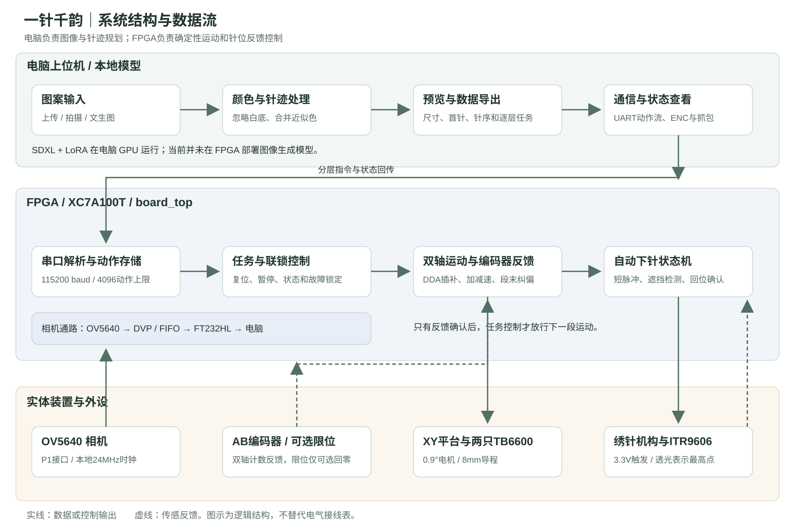
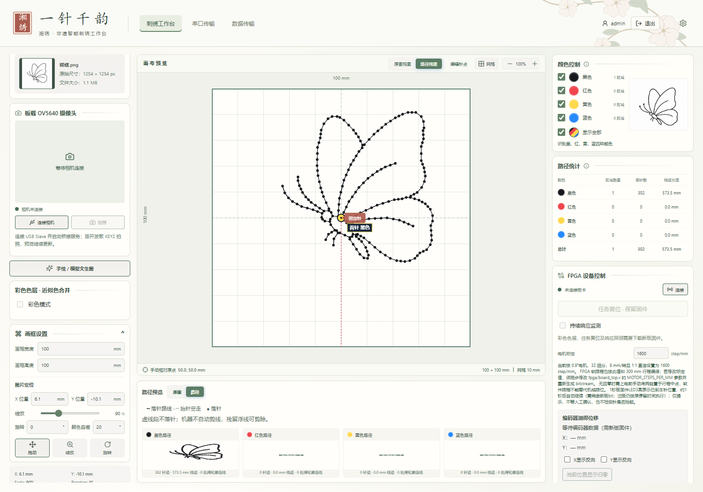
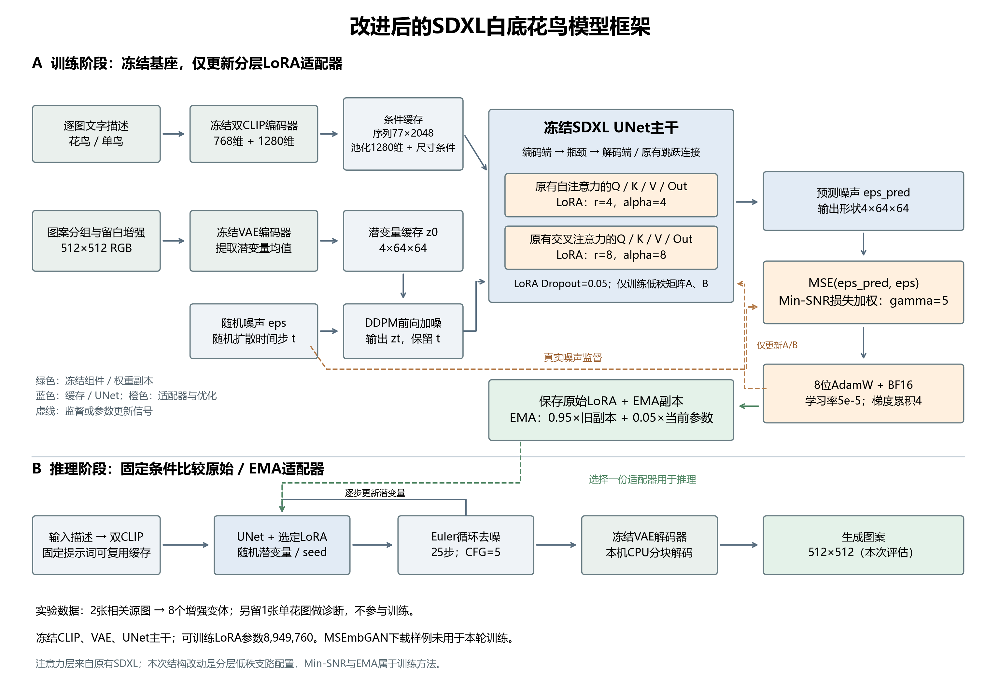
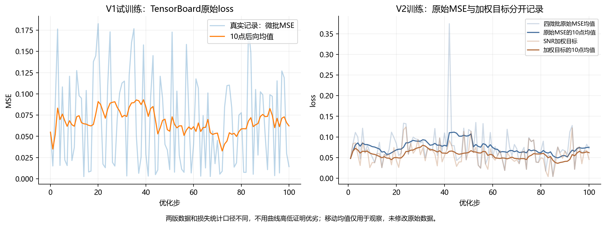
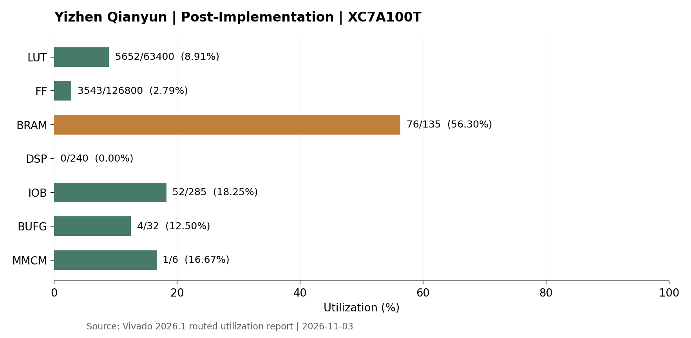

# 一针千韵——智能非遗刺绣系统设计报告

**版本**：自动下针与红外反馈版  
**目标器件**：AMD Artix-7 XC7A100T FGG484 -2  
**整理日期**：2026 年 11 月 3 日

## 摘要

一针千韵面向传统刺绣图案数字化与辅助制作，构建“图案输入—图像处理—针迹规划—分层传输—
双轴运动—自动下针”的系统。电脑侧提供图片上传、相机选图、文生图入口、颜色合并、路径预览和数据管理；
FPGA 侧完成串口解析、双轴插补、编码器反馈及红外针位检测，将路径数据转换为机构控制信号。
系统通过可保存的针序和分色任务连接数字图案与刺绣执行过程，减少重复人工整理。

本报告依据当前提交代码、真实仿真和 Vivado 实现报告撰写。当前自动下针固件已通过四项 RTL 仿真和
综合实现，生成对应 bit；针机构联调、20ms 脉冲适配和长期机械稳定性尚待实物验证。

**关键词**：非遗刺绣数字化；针迹规划；FPGA 多轴协同控制；红外针位反馈。

## 1. 设计目标与总体方案

传统图案要转化为机器可执行路径，需要处理图像背景、颜色、针序、尺寸和机构运动之间的对应关系。
本项目将用户操作集中到电脑上位机，把需要稳定时序的运动与针控交给 FPGA，形成可追溯的数据链路。

|设计目标|实现方式|
|---|---|
|多种图案来源|支持上传图片、真实相机拍摄及模型生成图片|
|便于刺绣的图案处理|忽略白色背景，合并近似颜色，按色层组织任务|
|可检查的针迹|显示首针、落针点和跳线，提供多种路径方式，保存审定图案的固定针序|
|运动与下针协调|段末运动反馈通过后触发针周期，回针确认后继续移动|
|运行可观察|查看串口收发、编码器计数、任务状态和通信响应|
|可复现交付|提供源码、真实工程、bit、测试、模型适配器、资料来源与文件校验|

### 1.1 系统结构

上位机负责图像分析、针迹规划和人机交互；FPGA 负责执行和反馈。
当前芯片是独立 Artix-7 FPGA，没有板载 ARM PS，本工程不以 PYNQ Overlay 为运行前提。
SDXL 推理运行在电脑 GPU 上，不能把它写成已经部署在 FPGA 上的神经网络加速器。

### 1.2 任务流程

1. 选择或生成图案，确认画框尺寸、比例、旋转和位置。
2. 排除白底、合并近似颜色，生成当前色层针迹。
3. 检查首针、越界、针距和跳线；导出标准 JSON/BIN，或转换成串口动作流。
4. FPGA 接收动作，执行 XY 运动并核对编码器反馈。
5. 刺绣动作到位后触发针机构；确认离开和返回上位后，允许下一段运动。
6. 当前色层完成后由操作者处理换线等工艺操作，再发送下一层。

这是一套分层执行系统，当前不包含自动换线机械装置，颜色分层不能等同于自动换线。

## 2. 硬件平台与接口设计

|模块|采用的硬件或条件|用途|
|---|---|---|
|控制板|正点原子达芬奇 Pro；XC7A100T，50MHz|实时控制与相机数据流|
|图像采集|OV5640，8 位 DVP、SCCB；兼容模组本地 24MHz 时钟|实时图像与选图|
|XY 驱动|两只 TB6600，配合美蓓亚 0.9°/1A 六线 42 步进电机|分别驱动 X/Y 轴|
|机械传动|8mm 导程，电机与丝杆按 1:1 配合|把轴转角转换为平移|
|位置反馈|每轴一个 1000PPR AB 相 NPN 开集电极编码器|计数与段末反馈纠偏|
|针位反馈|ITR9606 红外槽型传感器|判断针离开及返回上位检测区|
|针控输出|3.3V 高有效逻辑触发接口|向既有针机构发出短脉冲|
|电脑连接|USB-UART、USB Slave、JTAG|分别传输控制、图像和下载配置|

### 2.1 主要外接信号

|信号|底板接口|FPGA 球位|
|---|---|---|
|X STEP / DIR|J4-31 / J4-32|AA15 / AB15|
|Y STEP / DIR|J4-35 / J4-36|Y16 / AA16|
|X 编码器 A / B|J4-27 / J4-28|Y13 / AA14|
|Y 编码器 A / B|J4-33 / J4-34|AB16 / AB17|
|下针触发|J3-23|C18|
|针位输入|J3-27|D20|
|针位调试输出|J3-35|E16|
|可选 X/Y 回零限位|J3-17 / J3-19|C13 / C14|

编码器按现有开集电极接法供电，A/B 各通过独立 3.3kΩ 上拉至 3.3V。
ITR9606 发射端需要限流，接收端上拉至 3.3V。针最高点透光时输入为低，遮挡时为高。
下针 IO 只接兼容逻辑输入，不直接驱动电磁铁、针电机或动力电源。
板载时钟、按键和 LED 等为 LVCMOS15；外接控制接口为 LVCMOS33，不能统一改成同一种电压。

完整电源、拨码、线色、相机 P1 和 USB 接法见 [硬件清单与完整接线](../board/硬件清单与完整接线.md)，
最终约束见 [pins.xdc](../board/constraints/pins.xdc)。

## 3. 上位机与针迹数据设计

### 3.1 人机界面

上位机采用 React、TypeScript 和 Vite，提供登录、刺绣工作台、串口传输及数据查看页面。
图案来源包括普通图片、模型图片和相机选图。模型服务通过本机接口适配，凭证不打入提交包；
实际可调用的云模型取决于用户账号与权限。语音输入依赖浏览器能力和麦克风授权。

### 3.2 颜色与路径处理

近似色处理在 Lab 空间计算距离，使用像素颜色的加权中心合并相近色层，避免同一线色被拆成过多任务。
透明背景及白色/近白像素不参与刺绣颜色识别。当前实现默认最多 16 个候选色层，函数参数支持上限 32，
不是无限色线程。实际需要多少线色仍由图案和换线工艺决定。

普通图像可选择图结构、轮廓、填充和连续走线等方式；固定兔子、蝴蝶等图案读取已保存针序，
只作坐标映射，不在运行时重新规划最短路径。当前固定蝴蝶为 302 针单条闭合路线，
默认位置下内部无跨留白跳线；部分已有线条需要回走，不能据此保证所有面料不会卡线。

### 3.3 坐标与协议

图像坐标经过比例、位置和旋转映射为画框内毫米坐标，再按标定值转换为整数脉冲：

`step_x = round(x_mm × steps_per_mm)`，`step_y = round(y_mm × steps_per_mm)`。

串口发送相邻目标的增量，初始逻辑位置对应画框中心。J 表示针抬起移动，S 表示到目标后执行针周期。
上位机检查坐标有效性、画框边界和动作上限；超长增量分段传输，中间只移动，保留目标端的一次落针。
当前协议单次最多 4096 动作，单段增量需在 16 位有符号范围内。
BIN 是上位机标准导出文件，FPGA 常规入口使用转换后的 ASCII 动作流，不是把任意 BIN 字节直接发给串口。

## 4. FPGA 控制设计

### 4.1 模块划分

|源码模块|功能|
|---|---|
|board_top.v|板级引脚、时钟、相机通路及最终参数配置|
|top.v|任务状态、动作接收、运动/针周期调度与联锁|
|uart.v / protocol_parser.v / text_tx.v|串口接收、命令解析及状态文本回传|
|motion_xy.v|双轴 DDA 插补、有限加减速及段末反馈控制|
|encoder_monitor.v|AB 编码器计数与遥测|
|needle_ctrl.v / input_filter.v|针周期状态机、传感器同步和去抖|
|camera_usb_stream.v / ft232h_stream_start.v|相机跨时钟缓存、FIFO 数据流与 USB Slave 传输|
|ov5640_sccb_init.v|摄像头初始化与寄存器读取|

### 4.2 双轴运动和编码器反馈

双轴直线段采用 DDA 思路：以 `max(|dx|, |dy|)` 为主步数，通过误差累加分配次轴脉冲，
使两轴在同一段内协调运动。脉冲周期逐步缩短或增加，实现有限加减速；短线段未必达到最高频率。
最终板级默认从 400Hz 起步，上限 12000Hz，STEP 高电平 5µs。
ACCEL_TIME_MS=16 用于计算 192 个加速步，不表示机械加速过程固定持续 16ms。

电机步数标定为：`(360° / 0.9°) × 32细分 / 8mm = 1600 STEP/mm`。
编码器四倍频计数为：`1000 × 4 / 8mm = 500 count/mm`。
因此目标步数与编码器计数的比例为 `5/16`，代码采用 Q16 系数 20480。

段末反馈模块比较实际累计计数与目标，对超差进行有上限的低速纠偏；无进展、超时等条件会停止任务。
默认容差 10 count，按名义比例对应 0.02mm 反馈容差，**不是已经尺量确认的成品精度**。
编码器约每 200ms 通过 `ENC XXXXXXXX XXXXXXXX` 回传两轴计数。

### 4.3 自动下针与回针联锁

控制流程为：

`段末反馈通过 → 到位停稳 → 输出针脉冲 → 观察遮挡 → 观察恢复透光 → 稳定确认 → 下一段`。

|参数|当前默认值|作用|
|---|---:|---|
|传感器去抖|1ms|减少输入抖动|
|到位前等待 / 回针后确认|各 20ms|等待机构稳定及确认回位|
|高电平脉冲|20ms|触发针控接口，尚待实物调节|
|补发间隔|200ms|已检测下针但仍未回位时有条件补发|
|脉冲总上限|3 次|首次加最多两次补发|
|未观察到下针超时|1000ms|无有效下针反馈时锁定|
|回位超时|2000ms|未完成回位确认时锁定|

从未观察到遮挡时，不无限重复触发。运动中发现针不在上位、初始遮挡、针周期被暂停或反馈超时，
都会进入相应锁定处理。KEY0 不能绕过针故障；按作者要求不回传 ERR needle，针故障查询返回 BUSY。
红外检测证明离开与返回检测区，不单独证明针尖已到最低点、线张力正常或布面已经成功成针。

### 4.4 任务复位与相机

串口 RESET 或 KEY1 长按约 1.5s 清除任务，保留 PL 配置，当前位置成为新的逻辑原点。
当前 HOMING_ENABLE=0，不能把任务复位当成机械回零；可选限位也不是当前运行硬限位联锁。

相机由 SCCB 初始化，通过 DVP 输入像素，再经跨时钟 FIFO 和 FT232HL 同步 FIFO 通路送到电脑。
板级目标画面为 640×480 YUYV，KEY2 产生拍照事件。UART 控制口与 USB Slave 图像口分别使用。
PCLK 固定接 U18 并带布线例外；相机模组本地时钟和外部采样裕量仍需按实际模组确认。

## 5. SDXL 模型应用与改进实验

基准为 SDXL Base 1.0，固定版本 `462165984030d82259a11f4367a4eed129e94a7b`。
模型生成图片后仍需经过本项目的独立针迹规划，不直接输出针坐标。

本轮保持 UNet 主干、双 CLIP 编码器及 VAE 冻结，在原有注意力投影上插入 LoRA 支路：
自注意力 rank4、交叉注意力 rank8，dropout 0.05；采用 Min-SNR gamma5 和 EMA decay 0.95。
这些是任务适配与训练配置改进，没有重新训练整个 SDXL 基座，也没有把原有注意力称为新增主干结构。

实际训练为 100 步、512×512、batch 1、梯度累积 4、lr 5e-5，可训练参数 8,949,760。
两张相关源图增强为 8 张训练图，只算 1 个独立训练构图；一张花作为固定噪声诊断，不反向传播。
公开 MSEmbGAN 样例未参与本轮训练。

固定噪声诊断 raw MSE 从 0.04712881 降为 0.04298646，
下降约 8.79%。这只反映一个固定诊断条件，不等于通用生成质量或准确率提高同样比例。
已有 4 个版本、每版 2 个种子的 8 次实际推理记录；生成阶段约 14.31～15.29s，
包含该对照设置下 GPU 去噪和 CPU VAE 解码，排除了磁盘加载和冻结文本编码，不能宣传为端到端响应时间。
不同版本仍有图案边框等视觉问题，未据此宣称 V2 对所有指标全面优于 V1。

原始配置、CSV、图像及范围说明见 [模型真实结果](ml/改进说明与真实结果.md)。
基座外置下载，LoRA 和本轮输入随包，地址见 [下载清单](../data/数据集与基座下载地址.md)。

## 6. 实验与验证结果

### 6.1 软件、仿真与工程验证

|检查项目|已获得的结果|证据|
|---|---|---|
|前端回归|20 个测试文件、92 项检查通过|[测试日志](../build/frontend-tests.log)|
|前端构建|TypeScript 与 Vite 构建通过|[构建日志](../build/frontend-build.log)|
|浏览器交互|登录、错误密码拒绝、普通图路径及固定蝴蝶 UART 一致性通过|[浏览器记录](../build/browser-verification.json)|
|相机桥接软件|8 项离线单元测试通过|[验证清单](../build/validation.json)|
|红外针控 RTL|本次 4 项真实 XSim 测试通过|[本次仿真日志](../sim/verified-20261103/README.md)|
|Vivado 构建|综合、实现及 bit 生成通过|[原始构建日志](../build/release/vivado-build.log)|
|工程搬迁|新目录打开后 13 个 RTL 仍指向包内源码|[搬迁日志](../build/release/project-relocation.log)|

针控仿真覆盖正常周期、补发、未下针、未回位、初始遮挡、暂停/取消、KEY0 锁定及任务复位。
测试验证的是 RTL 在给定激励下的逻辑，不是实际缝纫机的动力响应。

### 6.2 FPGA 实现资源

以下来自 2026-11-03、Vivado 2026.1、board_top 的**布局布线后**报告，
器件为 xc7a100tfgg484-2，包含相机和自动下针控制。

|资源|已用|可用|利用率|
|---|---:|---:|---:|
|LUT|5,652|63,400|8.91%|
|FF|3,543|126,800|2.79%|
|BRAM|76|135|56.30%|
|DSP|0|240|0.00%|
|IOB|52|285|18.25%|
|BUFG|4|32|12.50%|
|MMCM|1|6|16.67%|

BRAM 是当前占比最高的资源，需结合图像缓存、动作存储等模块预算进一步评估。
当前 DSP 为 0，不能把电脑侧模型训练或图像运算写成 FPGA DSP 使用成果。
引脚约束包含 54 路顶层信号，报告的 Bonded IOB 为 52；端口数与实现资源统计不能混用。
数据来源：[implementation-utilization.rpt](../build/release/implementation-utilization.rpt)。

### 6.3 时序与发布文件

实现检查输出 `RELEASE_PASS setup=0.903 hold=0.084`；
最差 setup 裕量 0.903ns、hold 裕量 0.084ns，bit 大小为 3,825,989 字节。
DRC 无 Error，但存在配置电压声明、相机时钟、RAM 和 IO 缓冲等 Warning；
时序报告还列有 21 个 no_input_delay、16 个 no_output_delay 项。
这些结果不能解释为全部外部电气时序已经覆盖或机械精度已经通过。

- 工程：[yizhen_qianyun.xpr](../build/project/yizhen_qianyun.xpr)
- 固件：[yizhen_qianyun_auto_needle.bit](../board/firmware/yizhen_qianyun_auto_needle.bit)
- 源码与固件 SHA：[release-manifest.json](../board/firmware/release-manifest.json)
- 原始报告：[timing.rpt](../build/release/timing.rpt)、[drc.rpt](../build/release/drc.rpt)

### 6.4 尚需实机完成的验证

当前记录未包含本版自动下针固件的实板下载、实际成针和长时间机械测试。
后续应先检查针位极性，实测短脉冲是否完成正确动作，再验证两轴方向、尺度、少量针及逐色层任务。
尺量位移误差、重复定位、漏针、卡线和持续运行时间应记录原始数据后再报告。
串口 PING 响应统计与 ENC 更新间隔只能说明通信状态，不直接等于机构精度和整机稳定性。

## 7. 作品特点与工作分工

作品特点包括：一是把图案输入、路径检查、逐层传输和 FPGA 执行组织在同一流程中；
二是将双轴反馈和针位离开/返回确认相结合，防止针周期尚未确认时继续移动；
三是支持近似色合并、白底排除和审定针序保存，使路径更便于检查和工艺调整。
这些是本项目的工程集成特点，不宣称其基础算法在领域内首次提出。

作者主导作品方向、硬件与接口条件、刺绣工艺要求、功能取舍、现场反馈和交付要求，
承担实际接线、机构与操作调试。Codex 按需求辅助代码修订、实验、工具执行及材料整理。
详细分工见 [作者工作与大模型辅助记录](大模型辅助开发与协作记录.md)。

## 8. 复现与后续完善

根 README 提供完整复现与接线；源码集中在 src，仿真在 sim，工程/报告在 build，
固件在 board/firmware，模型输入和结果分别在 data 与 report/ml。
运行 `python build/verify.py` 可核对文件快照。安装依赖和下载基座后，可以运行上位机、模型推理和 RTL 构建。
工程使用相对路径，实际已核对与自动下针副本的源码一致性，并保留 bit 来源。

后续优先工作为实机针周期标定、短行程与成针验证、相机外部时序核查，以及扩大相互独立的花鸟训练样本。
在这些数据积累前，保持软件、RTL、实现和机械实测的结论分开记录。

## 资料索引

1. [总体复现与接线](../README.md)
2. [硬件清单及厂家资料](../board/硬件清单与完整接线.md)
3. [软件与构建验证](../build/validation.json)
4. [Vivado 原始实现报告](../build/release/README.md)
5. [模型基准与数据来源](ml/model-and-dataset-details.md)
6. [模型 CSV 与实际结论](ml/改进说明与真实结果.md)
7. [大模型协作记录](大模型辅助开发与协作记录.md)
